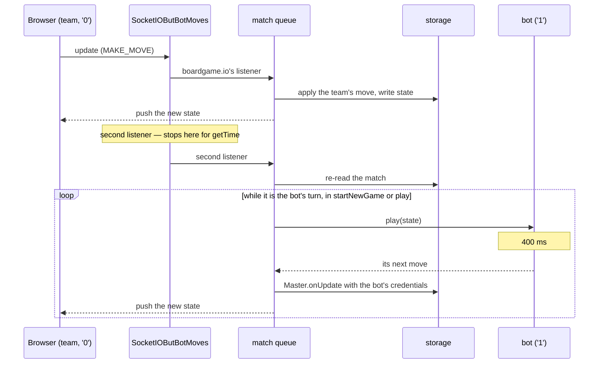

# How the live round works

The map of the competition round at runtime: what happens between a team typing
its join code and the organisers pulling the scores. It names the file that owns
each step and stops there — the reasons are in those files' comments, and the
rules for changing them are in [`AGENTS.md`](../AGENTS.md) and
[`README.md`](../README.md). The practice sites and the dry run reuse parts of
this; [the last section](#the-same-games-elsewhere) says which.

## Two players, one of them the server

Every match, relay or strategy, is a two-player boardgame.io match.

- Player `'0'`, `GUESSER_PLAYER`, is the team: the browser.
- Player `'1'`, `JUDGE_PLAYER` (`BOT_ID` on the server), is the bot, which runs
  inside the backend. In the relay it serves the problems and judges the
  answers; in a strategy game it supplies the opening position and plays the
  other side.

`PlayerIDType` in `packages/game/src/common/types.ts` defines both. The client
gets the game's rules but never the bot: what the bot knows (the relay's
answers, a strategy's lookup tables) lives in `relay-bot` and the `game/bot`
entry. The server and the dry run import both; the relay practice site imports
`relay-bot` for its judge.

## A team's way through the round

The team's row (the backend's `model.ts`) carries a `pageState` and the ids of its two
matches, `relayMatchID` and `strategyMatchID`. The page states
(`PAGE_STATES` in `schemas`) are `DISCLAIMER → HOME → RELAY | STRATEGY → HOME`,
and from `HOME` back to a finished `STRATEGY` (step 7).

1. **Import.** `team_import.ts`, from `npm run teams:import` or
   `PUT /team/admin/import`, creates each row in `DISCLAIMER` with both match
   ids null, in the competition its `Competition` column names
   (`competitionId`).
2. **Login.** `POST /team/join` swaps the join code for a session cookie;
   `team_session.ts` is what the cookie is and why. Every `/team/me` route but
   `logout` then loads the team through `requireTeam`.
3. **The team's view.** `GET /team/me` answers `publicTeamView` (`team_view.ts`)
   with both matches' status and the team's competition without its
   problems, from which the client builds its boards and the chooser shows
   only the matches the competition has. It also serves the team's start
   window (`teamStartWindow` in `start_window.ts`: the team's own, else its
   competition's, the one set on the admin page before the config's) and the
   server's time, by which the page keeps Start disabled outside the window. The frontend keeps that one object in
   `team-state-store.ts`, and `Main.tsx` picks the screen from its `pageState`.
4. **Disclaimer and home.** `POST /team/me/gohome` moves the team to `HOME`,
   from the disclaimer or after a match. It is refused while a match is in
   progress.
5. **Starting a match.** `POST /team/me/{relay,strategy}/play`, all in
   `router.ts` and `team_manage.ts`:
   - `allowedToStart` — one attempt at each kind of match, never both at once,
     never from the disclaimer;
   - `getNewGame` reads the team's competition from its source, picks the
     game it is played as (`relay`, or `strategy--<gameId>`), and builds the
     match's setup data from the competition as it stands; it answers 403 for
     a match the competition does not have, and for a start outside the
     team's start window. Only the start is held
     to the window: a match started in it runs its full time, and add-minutes
     may carry it past the window's end;
   - `createGame` creates an unlisted match under a fresh id, with that setup
     data;
   - `injectPlayer` seats the team as `'0'`, named by its `teamId` and holding
     its `credentials`, and `injectBot` seats the bot as `'1'`;
   - `claimStart` writes the match id and the new `pageState` to the row, but
     only if the row is unchanged since it was read (`TeamsRepository.startMatch`
     in `db.ts`). Of two racing starts, the loser's match is wiped.
6. **Playing.** The browser opens a boardgame.io socket.io client on the match
   — `ReactClient.tsx` in `online-frontend`, built by `client_factory.tsx` in
   `common-frontend` — and from here on every move is boardgame.io traffic, not
   REST.
7. **Looking back.** `POST /team/me/strategy/view` takes the team from `HOME`
   back to its finished strategy match, where the board shows it locked, as it
   ended. `allowedToViewStrategy` (`team_manage.ts`) allows it only
   for a finished strategy match while the relay is not running, and
   `TeamsRepository.viewStrategy` writes the page only if the row is still
   `HOME` with the match ids that were read, so a start landing in between
   wins. The relay has no such way back: its page would show only its last
   problem.

## How the bot gets its turn

boardgame.io's server has no notion of a server-side player, so
`SocketIOButBotMoves` (`socketio_botmoves.ts`) replaces its socket.io
transport. It adds two things to each game's namespace:

- a packet middleware that refuses a `sync` for a match storage does not have;
- a second `update` listener. After boardgame.io has applied the team's move, it
  re-reads the match and, if it is now the bot's turn in the `startNewGame` or
  `play` phase, asks the bot and submits its answer through a `Master` of its own,
  with the bot's credentials. The match's queue keeps this in order with the
  team's moves. The clock poll `getTime` is a read-only move, so it never wakes
  the bot (`isMakeMovePayloadReadOnly`).

One team move, and the bot's answer to it:

The game package's `botwrapper.ts` turns a strategy function — `(state, botID, setupData) => [args, moveName]`
— into a boardgame.io `Bot`. boardgame.io asks a bot for one move at a time,
and the strategy names the next move from the state it is handed, so a bot
keeps nothing between asks and one serves every match. The server plays the
bot's whole turn, asking again while the turn is the bot's, as one job on the
match's queue; `Local` in the dry run asks again after each accepted move.
Every move waits 400 ms, so the team sees what came before it land.

Since a strategy reads nothing but the state, a backend restart or a dry-run
reload halfway through the bot's turn costs nothing: the next ask continues the
turn. A turn planned as a whole, like `20ocde`'s two X's, is planned again from
the board as the turn found it, which the game keeps (`xsThisTurn`).

**A bot move the game refuses stalls the match.** The server plays nothing in
its place and logs the refused move (`socketio_botmoves.ts`): a refused move is
a bug in the strategy, and a random move instead could hand a live game to the
team unnoticed.

`hostedGames` (`games.ts`) lists each game beside its
bot, and `server.ts` builds both the game list and the bots from it.

## The two kinds of match

**One game per kind, not per competition.** The server hosts one relay game
and one game per strategy game, never one per competition: boardgame.io takes
its games when the server is constructed, so a game per competition would make
a competition added later — from a database, say — unplayable until a
restart. What a competition decides goes into the match's setup data when a
team starts it: the duration, and for a relay its problems with their answers
and points, read through `ProblemSource`. boardgame.io stores the setup
data in the match's metadata, so a match keeps the settings it started with
whatever happens to the competition later. The setup copies only the duration
into the match's state. The relay's problems and answers stay in the metadata,
where the server's judge reads them (`socketio_botmoves.ts` hands the bot the
match's `setupData`): no client is sent the metadata, but every client is sent
the match's *initial* state as stored, with no `playerView` applied, when its
board connects.

The backend reads competitions only through `CompetitionSource`, passed in by
`server.ts`, the one module that picks where they come from: the registry in
code and the database's `Competitions` and `Problems` tables together
(`database_sources.ts`). The registry is still validated whole at start, an id
both hold stops the server there, and a competition the source hands out is
validated each time it is read (`validatingCompetitionSource`). An ESLint rule keeps every other backend module off
`problem-bank/all`: only `server.ts` and the team import CLI pick the source.

**A strategy match** is the game's own definition wrapped by `gameWrapper`
(`gamewrapper.ts`), which owns the clock (30 minutes), the score and the phases:

- `startNewGame` — the team chooses `test` or `live`
  (`chooseNewGameType`), and the bot answers with the opening position
  (`setStartingPosition`);
- `chooseRole` — the team chooses who moves first. In a `test` game it may
  ask for another opening instead (`newStartingPosition`), which sends it back
  to `startNewGame` for the bot's answer alone;
- `play` — the game's own moves, until one sets `G.winner`. Then it is back to
  `startNewGame`, unless the game's move ended the whole match itself
  (`20ocde` does on a second win in a row).

A `live` sub-game's result is pushed to `G.liveResults`. In the `play` phase, a
move past the end plus `LATE_MOVE_GRACE_MS` ends the match. What a game folder
provides is [`README.md`](../README.md) § *Creating a new game*.

**A relay match** is `RelayWrapper` (`packages/game/src/games/relay/game.ts`).
It is not wrapped, and has its own clock (60 minutes). The team starts it, and
the judge's `firstProblem` serves the first problem, with every problem's points.
After that the turns alternate: the team's `submitAnswer`, then the judge's
`nextTry`, `newProblem` or `endGame`. The judge — `relayStrategy` in
`relay-bot`, over the match's own problems — decides which, and what a later
try is worth.

## A match's status and score

Nothing about a match is stored on the team row except its id.
`deriveMatchStatus` (`match_status.ts`) reads `NOT STARTED`, `IN PROGRESS` or
`FINISHED`, with the score, off the match's own game state, every time it is
asked. `/team/me`, `allowedToStart`, `allowedToViewStrategy`, `gohome` and
every admin view use it.

## What the organisers can do

All of it is in `router.ts`, behind `requireAdmin` (`admin_session.ts`), and
drawn by `Admin.tsx`:

- **Read** a team list with both matches' status, or one match's state, log or
  metadata.
- **Add minutes** to a running match: it moves `G.end` in storage, then pushes
  the new state to the team's open socket through the transport's `sendAll`.
- **Reset** a team's relay or strategy: the match id goes back to null, so the
  team may start that match afresh. The old id is kept in the team's `other`
  notes.

After the round, `scripts/admin.py` pulls every match through these routes and
writes the results ([`README.md`](../README.md) § *Admin*).

## The same games elsewhere

`common-frontend` talks to whatever is behind it through `ClientRepository`
(`api-repository-interface.ts`): `ONLINE` is the REST API above
(`online-frontend`'s `client-repository.ts`), `OFFLINE` is localStorage, `MOCK`
is for tests. The admin routes are a second interface, `AdminClientRepository`,
which only the online app provides: the admin page renders where it is, and
elsewhere `/admin` is an ordinary path.

- **The offline dry run** (`/proba-verseny/`) runs the same `game` package and
  the same bots in the browser, on `localWithBots` (`local-with-bots.ts` in
  `common-frontend`, a persisted boardgame.io `Local`),
  with the team's state in localStorage (`OfflineClientRepository`). The
  wrappers' report callbacks — `sendStrategyFunction` and `sendRelayFunction` —
  are how it uploads each step.
- **The relay practice site** (`/valto/`) runs the relay game in the browser,
  also on `localWithBots`, with `relay-bot`'s judge (`relayStrategy`) over its
  own problem sets — so a change to the judge's scoring changes this site too.
- **The strategy practice site** (`/jatekok/`) shares none of this: it runs on
  `strategy-engine`, without boardgame.io. Its own
  [`AGENTS.md`](../apps/strategy-practice/AGENTS.md) is the authority.
