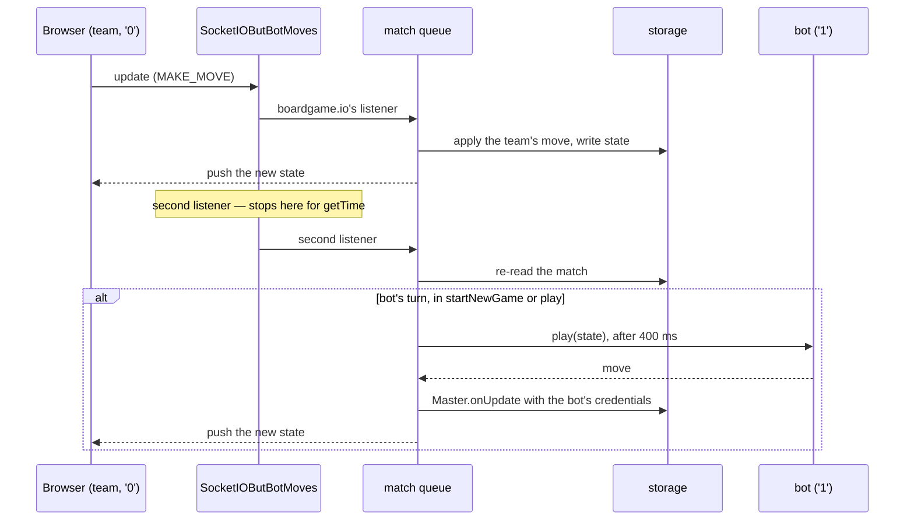

# How the live round works

The map of the competition round at runtime: what happens between a team typing
its join code and the organisers pulling the scores. It names the file that owns
each step and stops there — the reasons are in those files' comments, and the
rules for changing them are in [`AGENTS.md`](../AGENTS.md) and
[`README.md`](../README.md). The practice sites and the dry run reuse parts of
this; [the last section](#the-same-games-elsewhere) says which.

## Two players, one of them the server

Every match, relay or strategy, is a two-player boardgame.io match.

- Player `'0'`, `GUESSER_PLAYER`, is the team: the browser.
- Player `'1'`, `JUDGE_PLAYER` (`BOT_ID` on the server), is the bot, which runs
  inside the backend. In the relay it serves the problems and judges the
  answers; in a strategy game it supplies the opening position and plays the
  other side.

`PlayerIDType` in `packages/game/src/common/types.ts` defines both. The client
gets the game's rules but never the bot: what the bot knows (the relay's
answers, a strategy's lookup tables) lives in `relay-bot` and the `game/bot`
entry. The server and the dry run import both; the relay practice site imports
`relay-bot` for its judge.

## A team's way through the round

The team's row (the backend's `model.ts`) carries a `pageState` and the ids of its two
matches, `relayMatchID` and `strategyMatchID`. The page states
(`PAGE_STATES` in `schemas`) are `DISCLAIMER → HOME → RELAY | STRATEGY → HOME`.

1. **Import.** `team_import.ts`, from `npm run teams:import` or
   `PUT /team/admin/import`, creates each row in `DISCLAIMER` with both match
   ids null.
2. **Login.** `POST /team/join` swaps the join code for a session cookie;
   `team_session.ts` is what the cookie is and why. Every `/team/me` route but
   `logout` then loads the team through `requireTeam`.
3. **The team's view.** `GET /team/me` answers `publicTeamView` (`team_view.ts`)
   with both matches' status. The frontend keeps that one object in
   `team-state-store.ts`, and `Main.tsx` picks the screen from its `pageState`.
4. **Disclaimer and home.** `POST /team/me/gohome` moves the team to `HOME`,
   from the disclaimer or after a match. It is refused while a match is in
   progress.
5. **Starting a match.** `POST /team/me/{relay,strategy}/play`, all in
   `router.ts` and `team_manage.ts`:
   - `allowedToStart` — one attempt at each kind of match, never both at once,
     never from the disclaimer;
   - `getNewGame` picks the game by the team's category (`relayNames`,
     `strategyNames`);
   - `createGame` creates an unlisted match under a fresh id;
   - `injectPlayer` seats the team as `'0'`, named by its `teamId` and holding
     its `credentials`, and `injectBot` seats the bot as `'1'`;
   - `claimStart` writes the match id and the new `pageState` to the row, but
     only if the row is unchanged since it was read (`TeamsRepository.startMatch`
     in `db.ts`). Of two racing starts, the loser's match is wiped.
6. **Playing.** The browser opens a boardgame.io socket.io client on the match
   — `ReactClient.tsx` in `online-frontend`, built by `client_factory.tsx` in
   `common-frontend` — and from here on every move is boardgame.io traffic, not
   REST.

## How the bot gets its turn

boardgame.io's server has no notion of a server-side player, so
`SocketIOButBotMoves` (`socketio_botmoves.ts`) replaces its socket.io
transport. It adds two things to each game's namespace:

- a packet middleware that refuses a `sync` for a match storage does not have;
- a second `update` listener. After boardgame.io has applied the team's move, it
  re-reads the match and, if it is now the bot's turn in the `startNewGame` or
  `play` phase, asks the bot and submits its answer through a `Master` of its own,
  with the bot's credentials. The match's queue keeps this in order with the
  team's moves. The clock poll `getTime` is a read-only move, so it never wakes
  the bot (`isMakeMovePayloadReadOnly`).

One team move, and the bot's answer to it:

The backend's `botwrapper.ts` turns a strategy function — `(state, botID) => [args, moveName]`
— into a boardgame.io `Bot`. `args` of `undefined` means a random move from the
game's `possibleMoves`, and every answer waits 400 ms so the team sees its own
move land first. `competitionGames` (`games.ts`) lists each game beside its
bot, and `server.ts` builds both the game list and the bots from it.

## The two kinds of match

**A strategy match** is the game's own definition wrapped by `gameWrapper`
(`gamewrapper.ts`), which owns the clock (30 minutes), the score and the phases:

- `startNewGame` — the team chooses `test` or `live`
  (`chooseNewGameType`), and the bot answers with the opening position
  (`setStartingPosition`);
- `chooseRole` — the team chooses who moves first;
- `play` — the game's own moves, until one sets `G.winner`. Then it is back to
  `startNewGame`, unless the game's move ended the whole match itself
  (`20ocde` does on a second win in a row).

A `live` sub-game's result is pushed to `G.liveResults`. In the `play` phase, a
move past the end plus `LATE_MOVE_GRACE_MS` ends the match. What a game folder
provides is [`README.md`](../README.md) § *Creating a new game*.

**A relay match** is `RelayWrapper` (`packages/game/src/games/relay/game.ts`).
It is not wrapped, and has its own clock (60 minutes). The team starts it, and
the judge's `firstProblem` serves the first problem, with every problem's points.
After that the turns alternate: the team's `submitAnswer`, then the judge's
`nextTry`, `newProblem` or `endGame`. The judge — `relayStrategy` in
`relay-bot`, holding the problem bank — decides which, and what a later try is
worth.

## A match's status and score

Nothing about a match is stored on the team row except its id.
`deriveMatchStatus` (`match_status.ts`) reads `NOT STARTED`, `IN PROGRESS` or
`FINISHED`, with the score, off the match's own game state, every time it is
asked. `/team/me`, `allowedToStart`, `gohome` and every admin view use it.

## What the organisers can do

All of it is in `router.ts`, behind `requireAdmin` (`admin_session.ts`), and
drawn by `Admin.tsx`:

- **Read** a team list with both matches' status, or one match's state, log or
  metadata.
- **Add minutes** to a running match: it moves `G.end` in storage, then pushes
  the new state to the team's open socket through the transport's `sendAll`.
- **Reset** a team's relay or strategy: the match id goes back to null, so the
  team may start that match afresh. The old id is kept in the team's `other`
  notes.

After the round, `scripts/admin.py` pulls every match through these routes and
writes the results ([`README.md`](../README.md) § *Admin*).

## The same games elsewhere

`common-frontend` talks to whatever is behind it through `ClientRepository`
(`api-repository-interface.ts`): `ONLINE` is the REST API above
(`online-frontend`'s `client-repository.ts`), `OFFLINE` is localStorage, `MOCK`
is for tests. The admin routes are a second interface, `AdminClientRepository`,
which only the online app provides: the admin page renders where it is, and
elsewhere `/admin` is an ordinary path.

- **The offline dry run** (`/proba-verseny/`) runs the same `game` package and
  the same bots in the browser, on `localWithBots` (`local-with-bots.ts` in
  `common-frontend`, a persisted boardgame.io `Local`),
  with the team's state in localStorage (`OfflineClientRepository`). The
  wrappers' report callbacks — `sendStrategyFunction` and `sendRelayFunction` —
  are how it uploads each step.
- **The relay practice site** (`/valto/`) runs the relay game in the browser,
  also on `localWithBots`, with `relay-bot`'s judge (`relayStrategy`) over its
  own problem sets — so a change to the judge's scoring changes this site too.
- **The strategy practice site** (`/jatekok/`) shares none of this: it runs on
  `strategy-engine`, without boardgame.io. Its own
  [`AGENTS.md`](../apps/strategy-practice/AGENTS.md) is the authority.
